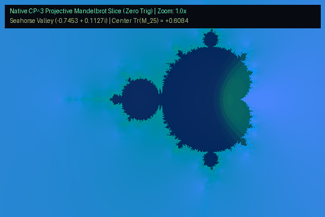

# KAN Model AI (`kan-model-ai`)

An analytical Kolmogorov-Arnold Network (KAN), trigonometry-free $\mathbb{CP}^3$ fractal feature encoder, and closed-loop visual telemetry suite built on projective spinor fibers, $\mathrm{erf}()$ radiative basis functions, and the 25-element $\Sigma_5$ freedom matrix.

---

## Core Architecture (Three Integrated Solutions)

### 1. Analytical Twistor-KAN Layer (`TwistorKANLayer`)
Replaces piecewise B-spline recursion (de Boor's algorithm) with a vectorized combination of analytical error-function ($\mathrm{erf}$) radial envelopes and harmonic Fourier frequencies along every network edge:

$$\phi_{q,p}(x_p) = \sum_{k=1}^{G} c_{q,p,k}\,\frac{1}{2}\left[1 + \mathrm{erf}\left(\frac{x_p - \mu_k}{\sqrt{2}\sigma_k}\right)\right] + a_{q,p,k}\cos(\omega_k x_p) + b_{q,p,k}\sin(\omega_k x_p)$$

Each transformed node state is embedded into $\mathbb{C}^5$ via scaled Penrose incidence $\omega^A = \frac{i}{L_0} X^{AA'} \pi_{A'}$ and evaluated across all 25 elements of the indefinite Hermitian metric $\Sigma_5$.

### 2. Native Trigonometry-Free $\mathbb{CP}^3$ Mandelbrot Feature Encoder (`ProjectiveCP3MandelbrotEncoder`)

Encodes arbitrary token and latent vectors directly onto the boundary dynamics of the Mandelbrot set in homogeneous projective twistor space $[ \omega^0 : \omega^1 : \pi_{0'} : \pi_{1'} ] \in \mathbb{CP}^3$ without trigonometric coordinate charts (`sin`, `cos`, `atan2`, `acos`) or floating-point overflow at infinity:

$$\omega^A_{k+1} = (\omega^A_k)^2 + C^A (\pi_{A',k})^2, \qquad \pi_{A',k+1} = (\pi_{A',k})^2$$

Projective re-scaling at each step compactifies the point at infinity onto the hyperplane $\pi_{A'} = 0$, lifting multi-scale fractal boundary invariants directly into $\mathbb{C}^5$ and the 25-element $\Sigma_5$ operator.

### 3. Closed-Loop Visual Telemetry & Self-Regularization (`MetacognitiveObserverLoop`)
Forms a differentiable feedback loop coupling `kan-model-ai`, `ai-vector-shield`, and `twistor-render-core`:
1. **Forward Edge & Fractal Pass:** Computes univariate edge activations and builds the $5 \times 5$ (`25-element`) freedom matrix $M^\alpha{}_\beta = Z^\alpha (\Sigma_5 Z)_\beta^*$.
2. **Z-Buffer-Free Manifold Projection:** Renders the active 25-element KAN state into an analytical 2D volumetric density field using continuous $\mathrm{erf}()$ transmittance.
3. **Structural Telemetry Feedback:** Extracts spatial Dirichlet gradient energy ($\|\nabla I\|^2$) and $\Sigma_5$ spinor trace invariants from the rendered manifold to damp high-frequency edge oscillation during backpropagation.

---

## Unified Four-Repository Architecture (`isopidi-stack`)

| Repository | Role in Stack | Core Mathematical Primitives |
| :--- | :--- | :--- |
| **[twistor-render-core](https://github.com/isopidi-stack/twistor-render-core)** | Z-Buffer-Free Volumetric & Fractal Renderer | Analytical $\mathrm{erf}()$ depth transmittance, GPO projectors, $\mathbb{CP}^3$ Mandelbrot slicing |
| **[ai-vector-shield](https://github.com/isopidi-stack/ai-vector-shield)** | Adversarial Trajectory & Manifold Firewall | Krein-space $SU(2,3)$ Berry holonomy, `PalatialRingBuffer`, closed-loop manifold gating |
| **[penrose-frontier-lab](https://github.com/isopidi-stack/penrose-frontier-lab)** | Theoretical Spinor & Operator Sandbox | 5-QN dual-spinor states $(\omega^A, \pi_{A'}, \phi)$, 25-element $\Sigma_5$ proof, Cartan transport |
| **[kan-model-ai](https://github.com/isopidi-stack/kan-model-ai)** | Analytical KAN & Fractal Feature Engine | Vectorized $\mathrm{erf}$/Fourier KAN edges, $\mathbb{CP}^3$ Mandelbrot encoder, differentiable observer loop |

---

## Run Standalone Audit Suite

    python tests\test_kan_metacognition_audit.py
